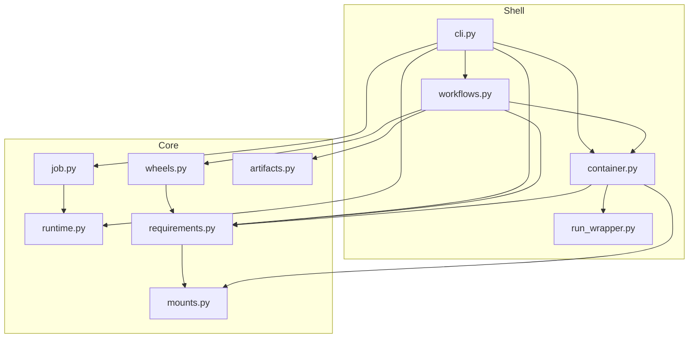

# Architecture

AWS Glue Toolkit is a **flat** Python package (no subpackages) organized in
**two layers**: **core** (domain) and **shell** (I/O and orchestration).

## Core

Domain facts, rules, and transforms. No CLI, Docker subprocesses, or terminal I/O.

| Module | Responsibility |
| --- | --- |
| `mounts.py` | Container mount constants; host→container path mapping |
| `runtime.py` | Bundled Glue version JSON → `GlueRuntimeMetadata` |
| `job.py` | `pyproject.toml` validation → `GlueJobProject` (merges `project.dependencies` then `tool.aws-glue-toolkit.dependencies`) |
| `requirements.py` | PEP 508 prep; `glue_image_pin_policy`; staged install workspaces; `DependencySession` / `open_dependency_session`; `PipRunner` type |
| `wheels.py` | `bundle_wheels`, internal dry-run report, Glue image pin omit |
| `artifacts.py` | Zip layout for `.dependencies.zip` and gluewheels tree staging |

Core modules must not import `container`, `cli`, or `workflows`. Allowed sibling
imports: `job` → `runtime`, `requirements` → `runtime`, `requirements` → `mounts`, `wheels` → `requirements`.

## Shell

Process boundaries and use-case orchestration:

| Role | Module | Responsibility |
| --- | --- | --- |
| **Infra** | `container.py` | `docker run` argv builders, `run_in_glue_container`, `run_pip_in_container`, `pip_runner`, `host_pip_runner`; host pip config snapshot → mounted `pip.conf` |
| **Infra** | `run_wrapper.py` | `spark-submit` entry for `gtk run`; clean container exit after the job |
| **Application** | `workflows.py` | `build`, `run`, `test`; `open_dependency_session` + injected `PipRunner` from `container` |
| **Presentation** | `cli.py` | `gtk` entry point, `GtkCommandError`, exit codes, Rich panels |

`workflows` raises domain exceptions (`PipError`, `DockerError`, `ValueError`,
`OSError`, `RequirementPreparationError`) for `cli` to translate.

## Module graph

- **Core** must not import `container`, `cli`, or `workflows`.
- **`requirements`** must not import **`container`** — use an injected `PipRunner` instead.
- Multi-step workflows that need both pip and Docker are wired in **`workflows`**. `cli` may import both for error mapping; `container` imports **`requirements`** for pip-in-container types and errors.
- **`run_wrapper.py`** is mounted into the Glue container by `container.run_in_glue_container` (Spark entry) as the `spark-submit` entry script.

## Command flows

**build**, **run**, and **test** use `open_dependency_session` (pin policy + prepared specs + `PipRunner`): pip `--constraint` omits image pins for direct overrides; gluewheels omit still compares against the full image catalog.

### `gtk build`

1. `artifacts.build_dependencies_zip` (host)
2. `workflows.build` → `open_dependency_session` → `bundle_wheels` → `write_gluewheels_tree` → zip

Host: path/VCS `pip wheel --no-deps` → dry-run resolve → per pin `pip download --only-binary` or sdist→wheel → portable assert; omit matching wheels from gluewheels.  
Container: `pip wheel` in Docker; omit matching wheels from gluewheels.

Use **`gtk build`** to verify dependencies (same pip recipes as packaging; writes zips on success).

### `gtk run` / `gtk test`

`cli` → `workflows.run` / `workflows.test` (`--platform native|worker`) →
`open_dependency_session` (when deps are present) →
`staged_requirements` → `container.run_in_glue_container`
(pip install ``--target`` then spark-submit / pytest in one ephemeral
container when a dependency session is open).

- **`--platform native` (default):** `build_run_argv` omits Docker
  ``--platform`` (multi-arch image matches the host).
- **`--platform worker`:** pass
  ``runtime.worker_docker_platform`` (no fallback to native).

Container ``pip_runner`` (``build --mode container``) always uses
``worker_docker_platform``.

For `gtk run`, `container.run_in_glue_container` with a Spark entry mounts
`run_wrapper.py` as the `spark-submit` entry so the container returns
after the job script finishes. **`workflows.test`** validates `tests_dir` before
calling the container adapter; **`run`** does not check the tests directory.

## Git and VCS dependencies

Git direct URLs are passed through to pip. See
[README.md](../README.md#dependency-forms) for supported forms and limits.

## Adding code

1. Fact, rule, or transform → core (`mounts`, `runtime`, `job`, `requirements`, `wheels`, `artifacts`)
2. Multi-step user workflow → `workflows.py`
3. Subprocess or Docker argv → `container.py`
4. In-container `spark-submit` entry for `gtk run` → `run_wrapper.py`
5. Terminal, Cyclopts, or exit codes → `cli.py`

If a change needs both pip and Docker for a user-facing workflow, wire it in
**`workflows`**, not in **`requirements`**.

## Public API

Library callers may import Python modules, but only the **`gtk` command-line interface** is stability-guaranteed (see [README.md](../README.md#stability)). Typical imports today:

- `from aws_glue_toolkit.job import load_pyproject, GlueJobProject`
- `from aws_glue_toolkit.runtime import load_runtime`
- `from aws_glue_toolkit.requirements import glue_image_pin_policy, prepare_requirements`
- `from aws_glue_toolkit.wheels import bundle_wheels`
- `from aws_glue_toolkit.artifacts import build_dependencies_zip`
- `from aws_glue_toolkit.workflows import build, run, test`

The `gtk` CLI is registered at `aws_glue_toolkit.cli:app`.
